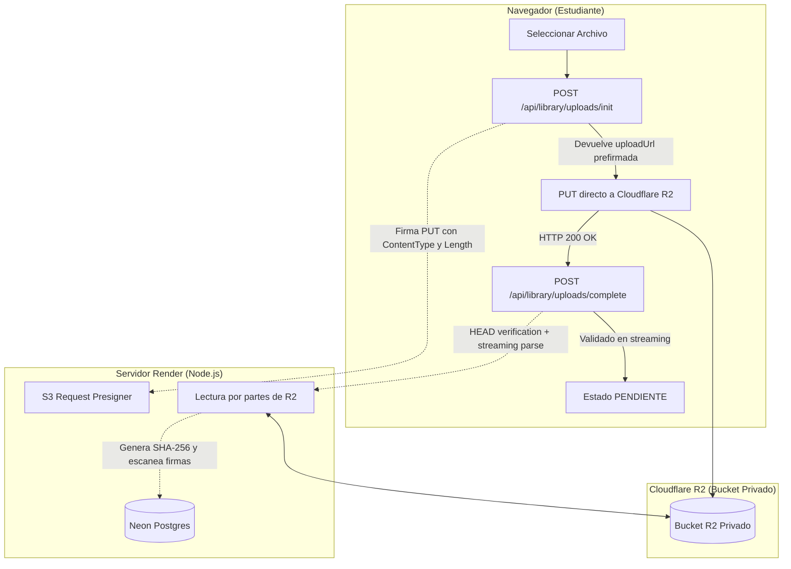
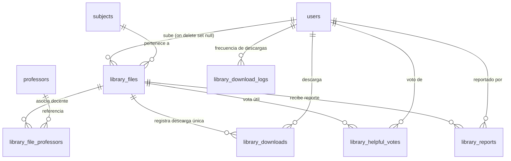

# Plan Completo: Biblioteca de Material de Estudio ("Stack")

Este documento detalla la arquitectura, modelo de datos, seguridad, contratos de API, pantallas y matriz de pruebas para la **Biblioteca de Material de Estudio** de la plataforma **Stack** (UTN - ISI).

---

## 1. Decisiones y Principios Fundamentales

1. **Aprobación Previa Obligatoria (Moderación Humana)**:
   - Todo archivo subido por un estudiante ingresa en estado `pending` tras completarse la validación técnica.
   - **Ningún material se publica automáticamente**. Solo se vuelve visible y descargable en el catálogo cuando un administrador lo aprueba desde el panel.
2. **Descarga Abierta para Usuarios con Email Verificado**:
   - Todo usuario con sesión activa y correo verificado puede descargar cualquier material aprobado.
   - No se exige "ratio de aportes", "créditos" ni requisitos de haber subido material previamente para poder acceder a los recursos de estudio.
3. **Tipos de Contenido Permitidos**:
   - `parcial` (con o sin resolución, número de parcial o recuperatorio).
   - `final` (con o sin resolución).
   - `apunte` (apuntes de clase teóricos/prácticos).
   - `resumen` (resúmenes de la materia o unidades temáticas).
   - `tp` (enunciados o desarrollos de trabajos prácticos).
   - `guia` (guías de ejercicios oficiales o complementarias).
   - `otro` (material complementario de la cátedra).
4. **Formatos y Extensiones Válidas**:
   - **Solo PDF e Imágenes**: `application/pdf` (`.pdf`), `image/jpeg` (`.jpg`, `.jpeg`), `image/png` (`.png`), `image/webp` (`.webp`).
   - Se prohíben explícitamente ejecutables (`.exe`, `.sh`), archivos ofimáticos (`.doc`, `.docx`, `.ppt`, `.pptx`, `.xls`), archivos comprimidos (`.zip`, `.rar`, `.7z`) u otros tipos de contenedor por riesgos de seguridad.
5. **Privacidad Estricta y Anonimato del Uploader**:
   - **Vista de Alumnos**: Nunca se expone el nombre, identificador ni correo del estudiante que aportó el material. En el catálogo público se muestra exclusivamente `"Subido por un estudiante"`.
   - **Vista de Administradores**: El administrador puede conocer la identidad del autor en caso de reportes, abusos o incumplimiento de reglas, pero cada consulta individual de identidad se registra de forma obligatoria e inmutable en la auditoría (`library.view_uploader`).

---

## 2. Arquitectura de Almacenamiento: Cloudflare R2

Los archivos binarios **no se almacenan en la base de datos Neon ni en el sistema de archivos del servidor en Render**. Se utiliza **Cloudflare R2** a través de su API compatible con Amazon S3 (`@aws-sdk/client-s3` y `@aws-sdk/s3-request-presigner`) con un bucket totalmente privado.



### 2.1 Variables de Entorno
* `R2_ACCOUNT_ID`: Identificador de cuenta de Cloudflare.
* `R2_ACCESS_KEY_ID`: Token de acceso con permisos de lectura y escritura exclusivos sobre el bucket.
* `R2_SECRET_ACCESS_KEY`: Secreto del token.
* `R2_BUCKET`: Nombre del bucket privado.
* `CONTACT_EMAIL`: Dirección de contacto para reclamos de derechos de autor (DMCA) o pedidos de baja.
* **Política de Validación**: Obligatorias exclusivamente en `production` (`env.ts`). En entornos locales (`development`) y en ejecución de tests (`test`), se utiliza un simulador en memoria (`MemoryMockR2Service`) para no requerir conexión real a R2 ni incurrir en costos.

### 2.2 Subida Directa (PUT)
1. El cliente invoca `POST /api/library/uploads/init` enviando metadata del archivo (nombre original, tamaño declarado, MIME declarado, materia, etc.).
2. El servidor valida cuotas, límites diarios y términos aceptados. Genera una clave aleatoria única (`library/<uuid>.<ext>`) que **no depende del nombre original ni puede colisionar con archivos existentes**.
3. Se firma una URL de subida `PUT` con vencimiento estricto de **10 minutos**, forzando los headers `Content-Type` y `Content-Length`.
4. El navegador sube el archivo directamente a R2 mediante `XMLHttpRequest` con barra de progreso en vivo, sin consumir memoria ni ancho de banda en Render.
5. El cliente invoca `POST /api/library/uploads/complete`. El servidor ejecuta un `HEAD` sobre R2 para comprobar que el tamaño y tipo real coincidan con lo declarado; luego lee el objeto en streaming para calcular el hash SHA-256 e inspeccionar firmas de seguridad. Si es válido, pasa el estado a `pending`. Si falla, se elimina de inmediato de R2.

### 2.3 Descarga Protegida (GET)
1. El usuario autenticado solicita la descarga mediante `GET /api/library/files/:id/download`.
2. El servidor verifica sesión, correo verificado y estado `approved` del archivo, aplicando el límite horario de descargas.
3. Se genera una URL prefirmada de lectura de un solo uso con vencimiento de **5 minutos**.
4. La URL fuerza los headers de respuesta para impedir la ejecución en el navegador:
   - `ResponseContentDisposition: attachment; filename="<nombre_sanitizado>"`
   - `ResponseContentType: <tipo_mime_validado>`
5. Se incrementa el contador de descargas únicas (si es la primera vez que el usuario baja este archivo).

### 2.4 Configuración CORS del Bucket R2
Ejemplo de configuración en formato JSON para Cloudflare R2:
```json
[
  {
    "AllowedOrigins": [
      "https://corre-ten.vercel.app",
      "http://localhost:5173"
    ],
    "AllowedMethods": [
      "GET",
      "PUT",
      "HEAD"
    ],
    "AllowedHeaders": [
      "Content-Type",
      "Content-Length",
      "x-amz-*"
    ],
    "ExposeHeaders": [
      "ETag"
    ],
    "MaxAgeSeconds": 3600
  }
]
```

---

## 3. Modelo de Datos Relacional (Drizzle ORM)

### 3.1 Tablas `library_*`



1. **`library_files`**:
   - `id`: UUID (Primary Key).
   - `uploader_user_id`: UUID (FK `users.id`, `ON DELETE SET NULL`). Nulo si el usuario se dio de baja o decidió no borrar sus archivos.
   - `subject_id`: UUID (FK `subjects.id`).
   - `kind`: Enum (`parcial`, `final`, `apunte`, `resumen`, `tp`, `guia`, `otro`).
   - `academic_year`: Integer opcional (ej. 2024).
   - `term`: Enum opcional (`1C`, `2C`, `A`).
   - `exam_instance`: Varchar(60) opcional (ej. "1er parcial", "Recuperatorio 2do parcial", "Final").
   - `has_solution`: Boolean (por defecto `false`).
   - `title`: Varchar(120) no nulo.
   - `description`: Text (hasta 500 caracteres).
   - `original_filename`: Varchar(255) sanitizado para descarga segura.
   - `storage_key`: Varchar(255) clave única en R2 (`library/<uuid>.<ext>`).
   - `mime_type`: Varchar(64).
   - `size_bytes`: Bigint / Integer.
   - `sha256`: Varchar(64) hash criptográfico.
   - `status`: Enum (`uploading`, `pending`, `approved`, `rejected`, `hidden`, `removed`).
   - `rejection_reason`: Text opcional (motivo comunicado al alumno en caso de rechazo).
   - `reviewed_by`: UUID opcional (FK `users.id`).
   - `reviewed_at`: Timestamp with time zone opcional.
   - `download_count`: Integer no nulo (contador de descargas únicas).
   - `helpful_count`: Integer no nulo (contador de votos útiles).
   - `created_at`, `updated_at`: Timestamps.
   - **Índices**: `(subject_id, status)`, `(status, created_at)` y único parcial `(sha256)` para evitar duplicados entre archivos no rechazados/removidos.

2. **`library_file_professors`**:
   - `file_id`: UUID (FK `library_files.id`, `ON DELETE CASCADE`).
   - `professor_id`: UUID (FK `professors.id`, `ON DELETE CASCADE`).
   - Clave primaria compuesta `(file_id, professor_id)`.

3. **`library_downloads`**:
   - `file_id`: UUID (FK `library_files.id`, `ON DELETE CASCADE`).
   - `user_id`: UUID (FK `users.id`, `ON DELETE CASCADE`).
   - `first_downloaded_at`: Timestamp.
   - Clave primaria compuesta `(file_id, user_id)` para asegurar el conteo de descargas únicas por estudiante.

4. **`library_download_logs`**:
   - `id`: Bigserial / UUID.
   - `user_id`: UUID (FK `users.id`, `ON DELETE CASCADE`).
   - `downloaded_at`: Timestamp.
   - Índice por `(user_id, downloaded_at)` para validar el rate limit horario.

5. **`library_helpful_votes`**:
   - `file_id`: UUID (FK `library_files.id`, `ON DELETE CASCADE`).
   - `user_id`: UUID (FK `users.id`, `ON DELETE CASCADE`).
   - `created_at`: Timestamp.
   - Clave primaria compuesta `(file_id, user_id)`.

6. **`library_reports`**:
   - `id`: UUID (Primary Key).
   - `file_id`: UUID (FK `library_files.id`, `ON DELETE CASCADE`).
   - `reporter_user_id`: UUID (FK `users.id`, `ON DELETE SET NULL`).
   - `reason`: Enum (`derechos_de_autor`, `contenido_inapropiado`, `incorrecto_o_enganoso`, `duplicado`, `otro`).
   - `note`: Text opcional.
   - `status`: Enum (`open`, `dismissed`, `actioned`).
   - `created_at`: Timestamp.
   - Restricción única `(file_id, reporter_user_id)`.

7. **`library_orphan_deletions`**:
   - `id`: UUID (Primary Key).
   - `storage_key`: Varchar(255) clave en R2.
   - `attempts`: Integer (reintentos de borrado en segundo plano).
   - `last_error`: Text.
   - `created_at`: Timestamp.

8. **Columnas Agregadas a la Tabla `users`**:
   - `library_terms_accepted_at`: Timestamp opcional (fecha de aceptación de términos de la biblioteca).
   - `library_terms_version`: Varchar(20) opcional (versión vigente de los términos aceptados, ej. `1.0`).
   - `library_last_checked_at`: Timestamp opcional (última vez que el usuario abrió su pestaña de materiales, utilizado para calcular el punto de aviso).

---

## 4. Cuotas, Límites y Reglas de Concurrencia

| Métrica / Restricción | Límite Máximo | Alcance |
| :--- | :--- | :--- |
| **Tamaño por archivo PDF** | 25 MB | Por subida individual |
| **Tamaño por archivo Imagen** | 10 MB | Por subida individual (JPG, PNG, WebP) |
| **Cuota total por estudiante** | 300 MB | Suma de bytes de archivos activos del usuario |
| **Límite diario de subidas** | 5 archivos / día | Ventana rodante de 24 horas por usuario |
| **Archivos pendientes simultáneos** | 10 archivos | En cola de moderación por usuario |
| **Límite de descargas** | 60 descargas / hora | Ventana de 1 hora por usuario |
| **Umbral de auto-ocultamiento** | ≥ 3 reportes generales<br>≥ 2 derechos de autor | Pasa archivo a `hidden` hasta revisión admin |

> [!IMPORTANT]
> **Seguridad ante Concurrencia (Race Conditions)**:
> Para impedir que múltiples peticiones simultáneas evadan la cuota de 300 MB, el límite de 5 subidas diarias o el tope de 10 pendientes, la verificación y reserva en `/uploads/init` se ejecuta dentro de una transacción de base de datos con bloqueo pesimista sobre la fila del usuario (`SELECT ... FROM users WHERE id = $1 FOR UPDATE`).

---

## 5. Los 10 Ajustes Aprobados en Detalle

### Ajuste 1: Borrado de Cuenta con Casilla "Eliminar también mis archivos"
* Tanto en la auto-eliminación (`DELETE /api/me`) como en la eliminación de una cuenta desde el panel de administración (`DELETE /api/admin/users/:id`), se incluye la opción `deleteFiles: boolean` (marcada por defecto como `true`).
* **Si se marca `deleteFiles: true`**:
  - Se eliminan físicamente los objetos en Cloudflare R2 y se borran los registros asociados en `library_files`.
  - Si la llamada a la API de R2 falla por red o indisponibilidad externa, la clave se encola en `library_orphan_deletions` para reintento automático y **no se bloquea ni cancela la eliminación de la cuenta**.
* **Si se desmarca `deleteFiles: false`**:
  - Los materiales aportados permanecen disponibles para la comunidad estudiantil, pero la columna `uploader_user_id` se setea a `null` (`ON DELETE SET NULL`), desvinculando cualquier dato del titular original.

### Ajuste 2: Restricción Estricta en URLs Prefirmadas (PUT) y Verificación HEAD
* La URL prefirmada de subida obliga la inclusión de los parámetros `ContentType` y `ContentLength` exactos declarados y validados en `/uploads/init`.
* En `POST /uploads/complete`, el backend ejecuta de forma obligatoria un comando `HeadObjectCommand` contra R2:
  - Comprueba que el objeto exista en el bucket.
  - Verifica que el tamaño en bytes (`ContentLength`) coincida exactamente con lo reservado.
  - Si no coincide o supera los límites permitidos, se borra el objeto de inmediato de R2 con `DeleteObjectCommand` y se rechaza la petición.

### Ajuste 3: Validación en Streaming Anti-Abuso (Sin Cargar en Memoria)
* El servidor en Render opera con recursos de memoria limitados. En `/uploads/complete`, el objeto se descarga de R2 mediante un `ReadableStream`:
  - Se calcula el hash criptográfico SHA-256 en tiempo real (`crypto.createHash('sha256')`).
  - Se verifica la firma binaria inicial (magic numbers) en los primeros bytes (`%PDF-`, `\xFF\xD8\xFF`, `\x89PNG`, `RIFF...WEBP`).
  - Para archivos PDF, se escanea el flujo en busca de directivas peligrosas (`/JavaScript`, `/JS`, `/Launch`, `/EmbeddedFile`, `/OpenAction`).
  - Se utiliza una ventana remanente de 64 bytes (`tailBuffer`) entre chunks sucesivos para que una palabra clave partida entre dos buffers no pase inadvertida.
  - Se establece un timeout máximo de 15 segundos para el análisis del stream, evitando bloqueos por streams lentos.

### Ajuste 4: Control de Cuotas y Límites bajo Transacción de Base de Datos
* Las comprobaciones de:
  1. Cuota máxima de 300 MB por estudiante.
  2. Límite de 5 subidas por día.
  3. Máximo de 10 archivos pendientes.
  4. Límite de 60 descargas por hora.
* Se ejecutan bajo transacciones de Postgres con serialización adecuada para neutralizar condiciones de carrera provocadas por llamadas paralelas.

### Ajuste 5: Acción "Suspender al Autor" desde el Panel de Administración
* Desde la previsualización de un material en la cola de moderación o desde la gestión de reportes, el administrador dispone del botón **"Suspender al autor"**.
* Exige reautenticación reciente (ticket vigente de reauth de menos de 10 minutos).
* Cambia `users.status = 'suspended'` y registra la acción en `admin_audit_log` con acción `library.suspend_author` y los detalles correspondientes (ID del archivo, motivo).
* La interfaz **no expone en pantalla el correo electrónico del autor**, preservando la privacidad por defecto y limitando la visibilidad del email a la acción explícita auditada `library.view_uploader`.

### Ajuste 6: Descarga Forzada Segura (`attachment`)
* Las URLs prefirmadas de descarga forzan la configuración:
  ```http
  ResponseContentDisposition: attachment; filename="<sanitized_name>"
  ResponseContentType: <validated_mime_type>
  ```
* Se previene que el navegador renderice o ejecute código HTML/SVG/scripts potencialmente incrustados en un documento.

### Ajuste 7: Documentación de Seguridad en README
* Se incluye una cláusula técnica y legal en el `README.md` especificando con claridad que el escáner de firmas y PDF es una **barrera de mitigación básica** y no sustituye un sistema antivirus integral de endpoint.

### Ajuste 8: Indicador Visual / Badge en Pestaña "Biblioteca"
* Se almacena en la tabla de usuarios la columna `library_last_checked_at`.
* Si un archivo subido por el alumno cambió de estado (de `pending` a `approved` o `rejected`) con fecha posterior a `library_last_checked_at`, la pestaña "Biblioteca" de la barra de navegación superior muestra un **punto de notificación visual (badge de novedad)**.

### Ajuste 9: Entorno Aislado y Simulación para Desarrollo / Pruebas
* La configuración en `library.config.ts` y `r2.service.ts` provee la implementación `MemoryMockR2Service`.
* Durante la ejecución de `npm test` o desarrollo local sin credenciales de Cloudflare, todas las operaciones de almacenamiento se gestionan en memoria.
* **No se ejecutan operaciones ni migraciones contra la base productiva de Neon ni contra el bucket productivo de Cloudflare R2**.

### Ajuste 10: Matriz Completa de Tests Automatizados
* Se contemplan suites de pruebas en backend (`server/test/library.test.ts`) y frontend (`test/libraryFrontend.test.ts`) que cubren:
  - Rechazo de formatos no permitidos (ZIP, DOCX, EXE) y tamaños excedidos (> 25 MB).
  - Detección de magic numbers falsos (ej. archivo EXE renombrado a `.pdf`).
  - Detección y rechazo de PDFs con directivas maliciosas (`/JavaScript`, etc.).
  - Rechazo de archivos duplicados por hash SHA-256.
  - Bloqueo por cuota máxima (300 MB) y tope diario (5/día).
  - Verificación de bloqueo ante términos de uso sin aceptar.
  - Invisibilidad de materiales pendientes y rechazados para estudiantes ajenos.
  - Bloqueo de edición/eliminación de archivos ajenos.
  - Garantía de anonimato del uploader en endpoints públicos.
  - Registro estricto en auditoría al consultar el autor desde el panel de admin.
  - Auto-ocultamiento al alcanzar umbral de reportes.
  - Conteo de descargas únicas y rate limit horario de descargas.
  - Limpieza periódica de subidas abandonadas (`uploading` > 2 horas).
  - Borrado de cuenta con eliminación de archivos en R2 vs desvinculación a null.

---

## 6. Especificación de Endpoints HTTP

### 6.1 Rutas de Alumnos (`/api/library`)
*Todos los endpoints requieren autenticación activa (`requireAuth`) y correo electrónico verificado (`requireVerifiedEmail`). Las mutaciones exigen token CSRF (`csrfProtection`).*

| Método | Endpoint | Descripción |
| :--- | :--- | :--- |
| `GET` | `/api/library/terms-status` | Devuelve si el usuario aceptó la versión vigente de los términos. |
| `POST` | `/api/library/accept-terms` | Registra la aceptación de los términos de la biblioteca. |
| `GET` | `/api/library/subjects` | Listado de materias con su respectivo conteo de materiales aprobados. |
| `GET` | `/api/library/subjects/:id/files` | Materiales aprobados de una materia (filtros por tipo, año, cátedra, orden). |
| `GET` | `/api/library/files/:id` | Detalle público del archivo (título, descripción, tipo, descargas, útil). |
| `POST` | `/api/library/uploads/init` | Valida límites y genera URL prefirmada PUT de R2. |
| `POST` | `/api/library/uploads/complete` | Valida el archivo subido en R2 y lo pasa a estado pendiente. |
| `GET` | `/api/library/files/:id/download` | Retorna URL prefirmada de lectura (GET) con headers forzados. |
| `POST` | `/api/library/files/:id/helpful` | Conmuta voto útil (toggle) del usuario sobre el material. |
| `POST` | `/api/library/files/:id/report` | Envía reporte con motivo y nota opcional. |
| `GET` | `/api/library/my-uploads` | Lista los archivos subidos por el propio usuario con sus estados y motivos. |
| `PATCH` | `/api/library/my-uploads/:id` | Permite al autor editar título, descripción o cátedra asignada. |
| `DELETE` | `/api/library/my-uploads/:id` | Elimina el material propio en R2 y en base de datos. |

### 6.2 Rutas de Administración (`/api/admin/library`)
*Requieren rol de administrador (`requireAdmin`), rate limiter específico y ticket de reautenticación reciente para acciones críticas.*

| Método | Endpoint | Reauth | Descripción |
| :--- | :--- | :---: | :--- |
| `GET` | `/api/admin/library/pending` | No | Listado de materiales en cola de moderación. |
| `GET` | `/api/admin/library/files` | No | Catálogo general de archivos (todos los estados, filtros y búsqueda). |
| `GET` | `/api/admin/library/files/:id/preview-url` | No | URL temporal para revisar el contenido del material antes de aprobar. |
| `PATCH` | `/api/admin/library/files/:id/approve` | No | Aprueba y publica el material en el catálogo de alumnos. |
| `PATCH` | `/api/admin/library/files/:id/reject` | No | Rechaza el archivo registrando motivo de rechazo. |
| `PATCH` | `/api/admin/library/files/:id/remove` | **Sí** | Oculta o da de baja un archivo publicado por reclamo o infracción. |
| `GET` | `/api/admin/library/files/:id/uploader` | **Sí** | Consulta la identidad del uploader y registra `library.view_uploader`. |
| `POST` | `/api/admin/library/files/:id/suspend-author`| **Sí** | Suspende la cuenta del autor y audita `library.suspend_author`. |
| `GET` | `/api/admin/library/reports` | No | Lista reportes abiertos de la comunidad. |
| `PATCH` | `/api/admin/library/reports/:id` | No | Desestima o marca como accionado un reporte. |

---

## 7. Pantallas y Componentes Frontend

### 7.1 Vistas para Estudiantes
1. **`LibraryHome.tsx` (Página Principal de la Biblioteca)**:
   - Buscador universal por materia, tipo de material o tema.
   - Navegación por nivel académico (1° a 5° año) y materias electivas.
   - Acceso directo a "Mis Aportes" con indicador de novedades (badge).
   - Acceso a Términos y Condiciones y botón destacado "Subir Material".
2. **`SubjectLibraryView.tsx` (Material de una Materia)**:
   - Pestañas/filtros por tipo de material (`Parciales`, `Finales`, `Apuntes y Resúmenes`, `TPs y Guías`).
   - Filtro por docente/cátedra y por año lectivo.
   - Tarjetas de material con tipo, título, año, si incluye resolución, tamaño y cantidad de descargas.
   - Botón de descarga directa con un clic.
   - Botón de "Es útil" (pulgar arriba) con recuento en vivo.
   - Menú contextual para reportar material inapropiado.
3. **`UploadMaterialModal.tsx` (Modal de Subida)**:
   - Arrastrar y soltar (Drag and drop) con validación inmediata en cliente de tipo y tamaño.
   - Selección de materia, tipo de material, año cursado, cuatrimestre e instancia de examen.
   - Selector opcional de docente o cátedra histórica.
   - Checkbox obligatorio de aceptación de términos de uso y derechos de autor.
   - Barra de progreso real porcentual durante la subida a Cloudflare R2.
4. **`MyUploadsView.tsx` (Mis Archivos y Estado de Moderación)**:
   - Grilla con los aportes del usuario.
   - Estados claramente diferenciados: `Aprobado` (verde), `En revisión` (amarillo), `Rechazado` (rojo con motivo visible).
   - Acciones para editar metadata o eliminar material.
   - Medidor visual del uso de cuota de almacenamiento personal (ej. `45 MB / 300 MB`).
5. **`LibraryTermsPage.tsx` (Términos de Uso y Propiedad Intelectual)**:
   - Cláusulas de responsabilidad, prohibición de contenido protegido comercialmente, procedimiento de reporte de infracciones y correo de contacto (`CONTACT_EMAIL`).

### 7.2 Vistas para Administradores
1. **`AdminLibraryTab.tsx` (Pestaña "Biblioteca" en Admin Dashboard)**:
   - **Subpestaña Cola de Moderación**: Materiales pendientes con visualizador embebido (PDF/imagen), datos técnicos, botones "Aprobar", "Rechazar" (con modal de motivo) y "Ver Autor / Suspender".
   - **Subpestaña Reportes**: Reportes enviados por estudiantes clasificados por motivo, con previsualización del material denunciado y acciones de desestimar o remover.
   - **Subpestaña Catálogo Completo**: Tabla con buscador y filtros avanzados para administrar cualquier material de la plataforma.
2. **`AdminOverviewTab.tsx` (Métricas Generales)**:
   - Indicador de materiales pendientes de revisión.
   - Total de archivos aprobados y volumen total ocupado en R2.
   - Alerta preventiva si el almacenamiento total supera los 8 GB (umbral del tier gratuito de 10 GB de Cloudflare R2).

---

## 8. Archivos del Proyecto Involucrados

### Archivos Creados
* `server/src/config/library.config.ts`: Constantes de cuotas, límites, tipos MIME y versión de términos.
* `server/src/services/r2.service.ts`: Abstracción de cliente Cloudflare R2 y mock en memoria.
* `server/src/modules/library/library.validator.ts`: Validación de magic numbers, sanitización y escáner streaming de PDFs.
* `server/src/modules/library/library.service.ts`: Lógica de negocio y transacciones de base de datos.
* `server/src/modules/library/library.controller.ts`: Controladores HTTP para estudiantes.
* `server/src/modules/library/library.routes.ts`: Definición de rutas `/api/library`.
* `server/src/modules/admin/admin.library.controller.ts`: Controladores de moderación y auditoría de la biblioteca.
* `server/drizzle/0005_library_material.sql`: Migración idempotente Drizzle para tablas `library_*`.
* `server/test/library.test.ts`: Pruebas de integración y seguridad del backend.
* `src/types/library.ts`: Tipos TypeScript compartidos.
* `src/api/library.api.ts`: Cliente HTTP de la biblioteca para el frontend.
* `src/components/library/LibraryHome.tsx`
* `src/components/library/SubjectLibraryView.tsx`
* `src/components/library/UploadMaterialModal.tsx`
* `src/components/library/MyUploadsView.tsx`
* `src/components/library/LibraryTermsPage.tsx`
* `src/components/admin/tabs/AdminLibraryTab.tsx`
* `test/libraryFrontend.test.ts`: Pruebas de interfaz y componentes.

### Archivos Modificados
* `server/src/config/env.ts`: Validación de variables R2 en producción.
* `server/src/db/schema.ts`: Definición de tablas `library_*` y columnas en `users`.
* `server/src/app.ts`: Registro de rutas `/api/library` y cron de limpieza de subidas huérfanas.
* `server/src/modules/auth/auth.service.ts`: Integración de la casilla "Eliminar mis archivos" en `deleteAccount`.
* `server/src/modules/admin/admin.service.ts`: Estadísticas de biblioteca y borrado de cuenta de usuario con archivos.
* `server/src/modules/admin/admin.routes.ts`: Rutas de moderación `/api/admin/library/*`.
* `src/components/common/Navbar.tsx`: Pestaña "Biblioteca" con icono de libro y badge de novedades.
* `src/App.tsx`: Enrutamiento de la vista `'library'` y modal de términos.
* `src/components/graph/SubjectDrawer.tsx`: Enlace contextual "Material de estudio (N)".
* `src/components/admin/AdminDashboard.tsx`: Pestaña "Biblioteca" en el panel.
* `src/components/admin/tabs/AdminOverviewTab.tsx`: Tarjetas de estadísticas de la biblioteca y alerta de cuota R2.
* `src/data/tutorialSteps.ts`: Paso de bienvenida y explicación de la biblioteca en el tutorial interactivo.
* `README.md`: Guía de configuración del bucket R2, permisos de token API, CORS y aclaración técnica sobre el filtro básico de PDFs.

